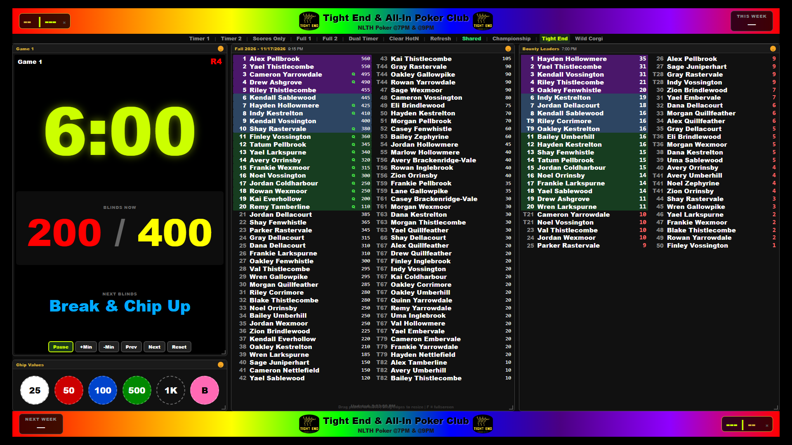
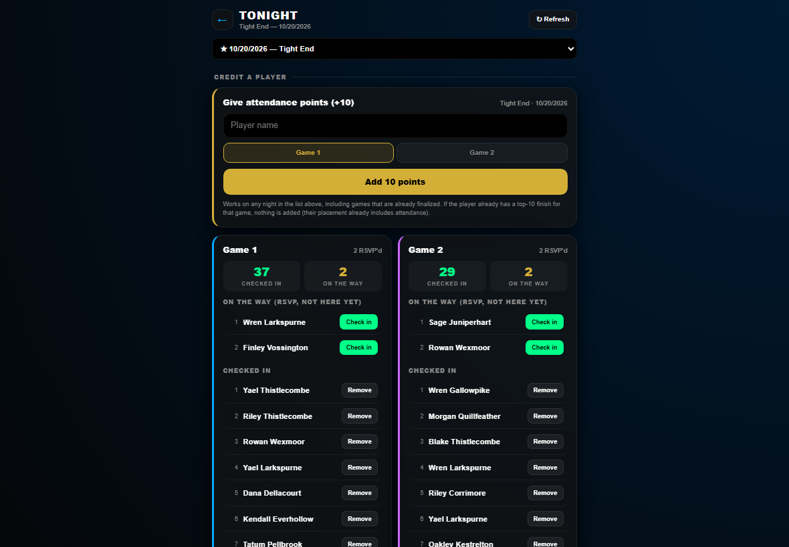
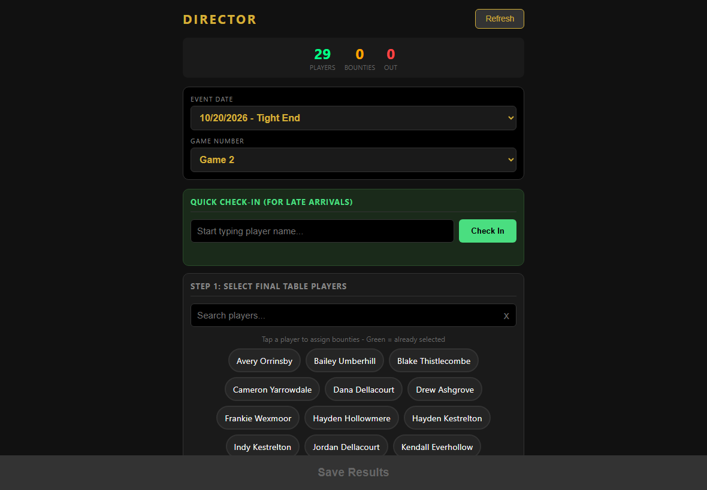
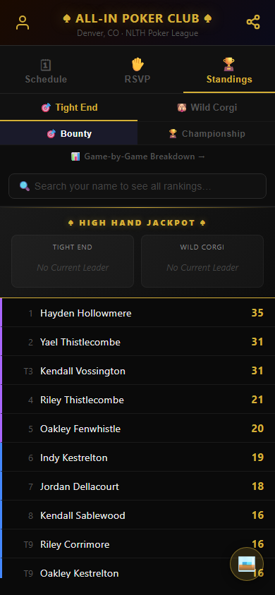
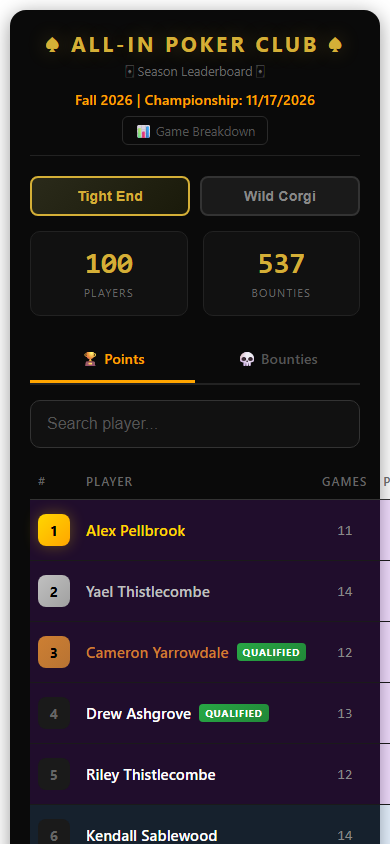
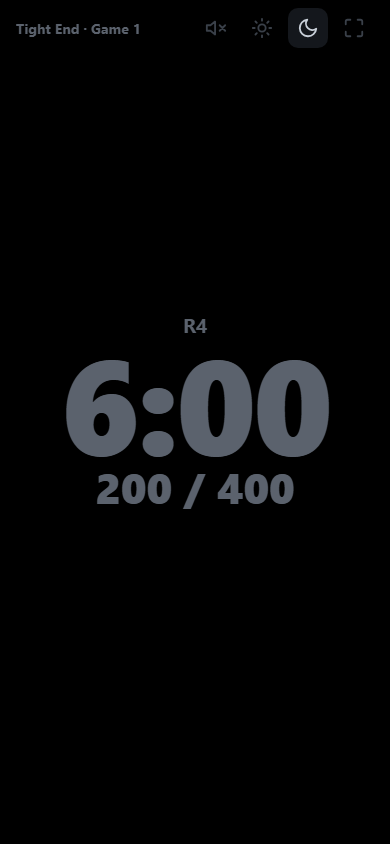

# Poker club app

League software for a bar poker club, used every week. The All-In Poker Club runs two nights a week at two bars, Tight End Bar and Wild Corgi, and this app runs the nights: check-in, scoring, standings, the venue clock on the TV, championship seating, and the drink rounds at the bar.

I design what it has to do and direct the AI coding agents that build it ([how I work with AI](#how-i-work-with-ai)). This repository is a cleaned copy of the private one. Every player, game and score in the demo data is generated.

## What it does and who uses it

- **Players** check in at the venue kiosk or on their phone, RSVP, follow the standings and their own stats, and see the clock from their seat.
- **Staff** run the night: a director page for eliminations, bounties and the final table, a review step before results are saved, the TV clock and its phone remote, and the bar board for drink rounds.
- **Admins** build the schedule and seasons, manage the roster, publish event pages, and send messages that are checked before they go out.

## Screenshots

Rendered on the generated demo data; more in [docs/screenshots](docs/screenshots/README.md).



| Staff: tonight at the venue | Staff: scoring the final table |
|---|---|
|  |  |

<p>
  
  
  
</p>

## How it works

It is plain HTML and JavaScript on Firebase: Hosting for the pages, Firestore for the data, Cloud Functions for everything that writes scores, and security rules that decide who can read or write what. A few design choices carry most of the weight:

- **Standings are always recomputed.** The leaderboard rebuilds from the raw game records on every request, reading three record formats from three eras through one branch each, so history never has to be rewritten.
- **The clock is an anchor, not a countdown.** It is stored as "at server time T there were N ms left on level L", so every screen agrees, phones and the TV stay in step, and the TV keeps running offline.
- **Totals are derived, not stored.** Drink totals come from the list of rounds on every read, because Firestore deep-merges map fields.
- **One module per rule.** One name matcher for every player search, one seating module and one definition of an open seat for every championship screen.
- **Open where it should be.** Check-in, RSVP and adding yourself work without signing in, because the venue kiosk runs signed out and new players have no account yet. Player emails live in a collection only the server can read.

## Where to look first

| Piece | Files | What to notice |
|---|---|---|
| Scoring and the review before finalize | `functions/index.js` (`finalizeGame`, `getLeaderboard`, `previewGameSubmission`, `calculateTiePoints`, `appToday`) | Three record formats coexist in one leaderboard, each with its own branch. The review returns FULL, PARTIAL or BLOCK, and staff can still close a night if the review itself cannot run, with that submission logged as unverified. |
| Security rules | `firestore.rules`, `storage.rules`, `docs/FIRESTORE_RULES_PROPOSAL.md`, `scripts/rules-test.js`, `scripts/rules-emulator-test.js` | Every collection is listed with who may read or write it, derived from the reads and writes the pages make; anything unlisted is denied. The same cases run offline on the Firestore emulator. |
| Player emails | `docs/PLAYER_EMAIL_PRIVACY.md`, `functions/scripts/migrate-player-emails.js`, `scripts/callables-emulator-test.js` | Player records are public so the signed-out kiosk can read them; emails live in a collection only the server can read. The migration copies, reads back and only then clears. |
| The synced clock | `public/clock-engine.js`, `clock-sync.js`, `clock-view.js`, `clock.html`, `staff/clock-control.html`, `docs/timer-prd/07-synced-clock.md` | The anchor model, a measured offset from server time, and a log of presses that makes any pause traceable. |
| Championship seating | `public/champ-seating.js`, `championship-director.html`, `champ-night.html`, `scripts/championship-seating-test.js` | One module and one definition of an open seat, shared by every championship screen, with the same tiebreaks everywhere. |
| Offline support | `public/sw.js`, `scripts/sw-check.js`, `docs/sw-reenable-test-2026-10-14.md` | The service worker caches only the site's own files and deletes only its own old caches; a dependency-free check runs before every release. |
| Drink rounds | `public/shots.html`, `bar.html`, `shot-orders.js`, `shots-reopen.js`, `scripts/shots-reopen-test.js`, `scripts/shot-order-clean-test.js` | Totals derived from the list of rounds on every read. Orders come from a signed-in session, and the rules check every field of a round. |
| Checks before anything is sent | `functions/scripts/check_*.py`, `audit_gameday_theme.py`, their tests and `*_expectations.json` | Push messages, event pages, player names and email blasts are checked against expectations frozen before any live model call. The checks list things for a person to read; they never block or rewrite. |
| Roster cleanup | `functions/scripts/player-sweep.js`, `player-merge.js`, `.claude/commands/player-sweep.md` | A read-only proposer, a writer that is a dry run unless told otherwise, one confirmation per group, and declined pairs remembered so they are never proposed again. |
| AI in the weekly routine | `.claude/commands/enter-scoresheet.md`, `audit-scores.md`, `season-health.md`, `scripts/season_health.py` | A photo of the paper scoresheet becomes a finalized game through the same director page staff use, and scheduled checks look over each season's data. |
| How the agents are briefed | `CLAUDE.md` | "If something here disagrees with the code, the code wins": the scoring model that must not drift, the deploy contract, and the open work. |
| Demo data | `demo/seed.js`, `demo/check-no-real-data.js`, `demo/fixtures/` | A generated club with two venues, a closed and a live season, ties, bounties, RSVPs, championship seating, drink rounds and clocks. The same seed gives the same bytes every run, and a check fails if the fixtures drift or anything resembling real data appears. |
| Sample invoices | `demo/sample-invoice.js`, `demo/invoices/`, `scripts/sample-invoice-test.js` | How attendance becomes a bill, on generated check-ins at two invented venues and a $6 demo rate. Each person counts once a night, removed check-ins are not billed, and the code refuses to invoice the club's real venues. |

## Safeguards and tests

- **Rules decide who can write what.** Server functions write every score and check the caller's role; the security rules cover every direct read and write a page makes.
- **A review before results are saved.** Each finalize gets a read-only review first, and a person reads anything it lists.
- **Checks before anything is sent.** Messages and event pages are checked against frozen expectations, and the checks report to a person rather than act on their own.
- **One time zone.** Every server-side "today" is pinned to the club's time zone, so a game night is one date from setup to close.
- **A release rhythm.** Releases go out weekly on Saturdays, never on a game night, after the service worker check.
- **Tests.** Eight Node checks (clock engine, clock pick, championship seating, two for drink rounds, service worker, inspector edits, sample invoices) and a check that no real data is in the tree; 383 Python tests for the pre-send checks; 86 rule cases and 33 server-function cases on the Firestore emulator.

[DESIGN-LOG.md](DESIGN-LOG.md) has the dated design decisions, from the first version in December 2025.

## How I work with AI

I learned this way of working in graduate school. As a linguist I was often paired with a computer science student. I brought the broad view and most of the ideas, and knew enough computer science to show what needed doing and which tools fit; my partner wrote most of the code. We argued it back and forth until it worked.

I still work that way. Now my computer science partners are AI agents, Claude Code and Codex. This app took shape over eleven months, from December 2025 to October 2026, one game night at a time: each night showed what the next change should be, and each change shipped with a check. The agents write most of the code. I own the design, the decisions about what the app must and must never do, and what counts as done.

AI is also part of the weekly routine. A photo of the paper scoresheet becomes a finalized game through the same director page staff use, roster cleanup runs as a guided agent command, and scheduled checks look over each season's data. `CLAUDE.md` is how the agents are briefed. Comments and agent instructions call me "the owner".

## Scope of this copy

- The demo runs on generated data. The live project, its address and the club's records are not included.
- The Firebase emulators run the rule tests and load the demo data.
- [docs/screenshots](docs/screenshots/README.md) shows ten pages rendered on the demo data.
- Left out of this copy: a host assistant on the staff night page, a player help desk, and the button for a separate event contest app.

## Running it

The offline checks need only Node 20 or later and Python 3.10 or later:

```
npm test            # eight Node checks, then the check that no real data is in the tree
npm run test:py     # five Python test files for the pre-send checks
npm run seed        # regenerate demo/fixtures; the output is the same on every run
npm run invoices    # regenerate the sample invoices in demo/invoices
npm run screenshots # render the pages on the demo data in headless Chromium (Playwright)
```

These run on the Firebase emulators and need the Firebase CLI, Java 21, and `npm ci` in `functions/`:

```
npm run test:rules  # the security rules and two server functions
npm run test:seed   # load the demo data into the Firestore and Auth emulators
```

This repository is a cleaned copy of the private one, which holds about 170 commits. Its history starts at publication.

All rights reserved. The code is published to be read; see [LICENSE](LICENSE).
